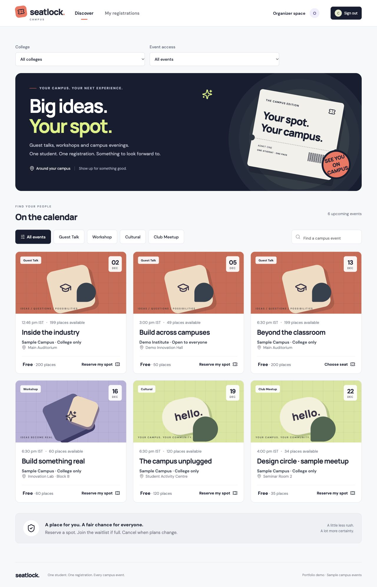

# SeatLock Campus

A full-stack event registration app for colleges. Organizers create college workspaces and events; students verify their email, reserve a place and receive a QR pass. Full events use a first-in, first-out waitlist.



## Features

- Separate student and organizer accounts with email verification.
- College workspaces with owner-managed organizer teams.
- **College-only events:** registration requires the configured college email domain.
- **Open events:** anyone with a verified email can register.
- Configurable capacity from 1 to 500, with optional numbered seating.
- One active registration per student account per event.
- Cancellation with automatic promotion of the next waiting student.
- QR attendance with duplicate check-in protection.
- Search, college/category filters and responsive layouts.

## Workflow

**Organizer:** Create account → verify email → create college workspace → create event → choose audience and capacity → manage registrations and check-in.

**Student:** Create account → verify email → find event → register or join waitlist → receive QR pass after confirmation → show pass at entry.

When a confirmed student cancels, the first waiting student is promoted automatically. Queue and pass status refresh every five seconds while the registrations page is open.

## Tech stack

| Layer | Technologies |
| --- | --- |
| Frontend | React, TypeScript, Vite, CSS |
| Backend | Java, Spring Boot, Spring JDBC |
| Database | PostgreSQL; persistent H2 for local development |
| Email and QR | Spring Mail, qrcode, ZXing |
| Testing | JUnit integration tests, Python HTTP and SMTP tests |

## Local setup

Install **Java 17+**, **Maven 3.6.3+**, **Node.js 22.12+** and npm.

```sh
git clone https://github.com/Gaurakumar-s/seatlock-campus.git
cd seatlock-campus
bash scripts/run.sh
```

Open [http://127.0.0.1:8080](http://127.0.0.1:8080). Stop the server with Ctrl+C. The default H2 database persists in `backend/data/seatlock-campus.mv.db`.

### Try the sample college

The local demo creates fictional events for **Sample Campus**.

- Student: create an account with a sample address at `campus.example.test`.
- Organizer email: `organizer@campus.example.test`
- Local demo password: `Campus-demo-2026!`
- Verify either account using **Send verification code → Open my test inbox**.

Development mode sends no real email and must remain local. Email-domain verification controls event access; it does not independently establish student enrolment or official college authorization.

### Real email

Set `MAIL_MODE=smtp`, `MAIL_FROM`, `SMTP_HOST`, `SMTP_PORT`, `SMTP_USERNAME` and `SMTP_PASSWORD` in the environment before starting the app. Authentication and required STARTTLS are enabled by default. The local test inbox is disabled in SMTP mode.

See [email setup](docs/email-setup.md) for the full instructions. Keep credentials out of Git. Real external inbox delivery requires a configured SMTP provider.

### PostgreSQL

Create a dedicated database, then start the app with its connection settings:

```sh
DB_URL=jdbc:postgresql://localhost:5432/seatlock_campus \
DB_USER=seatlock DB_PASSWORD=your-local-password \
bash scripts/run.sh
```

### Build a runnable JAR

```sh
bash scripts/package.sh
cd backend
java -jar target/seatlock-1.0.0.jar
```

The JAR bundles the frontend and needs only Java at runtime. Set `PORT=8081` to use a different port.

### Docker

Copy `.env.example` to `.env`, fill in the database and SMTP settings, then run:

```sh
docker compose up --build
```

Compose supplies PostgreSQL 16 and the application. Direct Java/shell launchers read environment variables; only Compose automatically reads `.env`.

## Live hosting

Use [the deployment guide](docs/deployment.md) for Render, persistent PostgreSQL on Neon and real verification emails through Brevo's HTTPS API. `render.yaml` includes the hosting configuration; enter database and email credentials only in Render's environment settings. Updating the same service keeps its URL.

## Tests

```sh
mvn -f backend/pom.xml test
```

The test suite covers registration races, waitlist order, QR admission, verification codes, college domains and organization access. Registration and organization tests run against H2 and PostgreSQL 16; delivery tests also verify the HTTPS email contract.

Additional checks:

```sh
# Requires a packaged JAR; uses a temporary app and local SMTP capture server.
python3 scripts/smtp_smoke_test.py

# Requires a disposable local app on port 8081 in development email mode.
python3 scripts/contention_test.py --url http://127.0.0.1:8081 --database-label PostgreSQL-16
```

A local 100-account experiment produced one confirmation and 99 waitlist entries for a one-place event, with no overbooking. These are synthetic local results, not production traffic.

GitHub Actions runs the H2 tests, builds the frontend/JAR and runs the tests against PostgreSQL.

## How allocation stays consistent

Registration, cancellation and check-in use database transactions and lock the event row before updating state. Database constraints enforce one active registration per student/event. Cancellation and waitlist promotion commit together; request keys make registration retries safe. Organizer permissions are checked against the workspace stored in the database.

## Documentation

- [API reference](docs/api.md)
- [Email setup](docs/email-setup.md)
- [Verification results and limitations](docs/verification.md)
- [Project write-up](docs/project-writeup.pdf)

Planned improvements include college SSO, multiple verified domains, promotion emails, event editing, secure cookie sessions and broader rate limiting. The app currently supports one exact email domain per college workspace. External email delivery, physical camera hardware and Docker runtime still need environment-specific verification.
